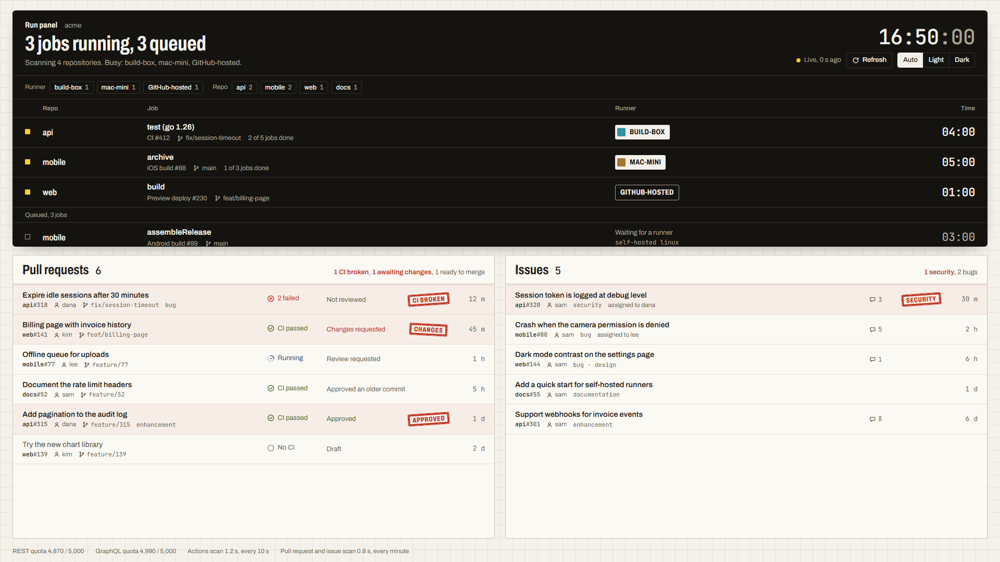
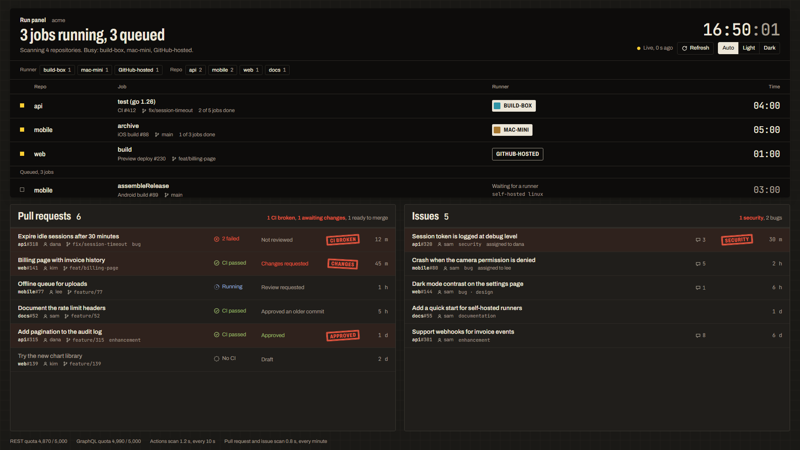

# GitHub Run Panel

A one-page live view of your GitHub work: running and queued Actions jobs at the top, and every open
pull request and issue across your accounts and organisations below. It is built for a desktop
monitor (1920×1080) and you can leave it open all day.





*The screenshots show the built-in demo data.*

- **Actions board:** running and queued jobs, which runner they are on (self-hosted or GitHub-hosted), and live timers. Filter by runner or repository. Updates every 10 seconds.
- **Pull requests:** CI state and review state, with a stamp on the rows that need you (CI broken, changes requested, ready to merge). Updates every minute.
- **Issues:** labels, assignees and comment counts, with a stamp for the labels you choose (`security` by default).
- **Interface:** English or Turkish, picked from the browser language. Light, dark or automatic theme.
- **Dependencies:** none. It is one Node file for the server and one HTML file for the page.

## Requirements

- [Node.js](https://nodejs.org) 26 or newer
- [GitHub CLI](https://cli.github.com) (`gh`), signed in

## Quick start

```sh
gh auth login
git clone https://github.com/derinbay/github-run-panel.git
cd github-run-panel
npm start
```

`npm start` opens <http://localhost:4747> in your browser. If you have no `config.json`, the panel
scans the repositories of the account `gh` is signed in as.

To try the panel without a GitHub account, run `npm run demo`. It serves made-up data.

## Run in the background

To start the panel at login with no terminal window:

```sh
npm run install-service     # register at login, start now and open the browser
npm run status              # login item, server state, log file
npm run stop                # stop it until the next login
npm run start-service       # start it again
npm run uninstall-service   # stop it and remove the login item
```

None of these need administrator rights.

| OS | Registration | Log |
|---|---|---|
| Windows | `github-run-panel.vbs` in the Startup folder | `%LOCALAPPDATA%\github-run-panel\server.log` |
| macOS | LaunchAgent `~/Library/LaunchAgents/io.github.github-run-panel.plist` | `~/Library/Logs/github-run-panel/server.log` |
| Linux | systemd user unit `github-run-panel.service` | `~/.local/state/github-run-panel/server.log` |

Every login item points at this folder and at the Node binary you ran it with. If you move the
folder or change your Node install, run `npm run install-service` again.

## Configuration

Copy `config.example.json` to `config.json` and edit it. Git ignores `config.json`.

| Key | Default | Meaning |
|---|---|---|
| `owners` | `[]` | The organisations or users to scan. When empty, the panel scans the account `gh` is signed in as. |
| `excludeRepos` | `[]` | The `owner/name` repositories to skip. |
| `includeArchived` | `false` | Whether to scan archived repositories. |
| `intervalSeconds` | `10` | How often the Actions board refreshes. The minimum is 5. Pull requests and issues refresh every minute. |
| `port` | `4747` | The local port. |
| `sealLabels` | `["security"]` | The issue labels that get a stamp, most important first. |

The `OWNERS` (comma-separated) and `PORT` environment variables override the file.

The page's language follows the browser. Add `?lang=en` or `?lang=tr` to the URL to choose one.

## Security

- The server listens on `127.0.0.1` only. It rejects any request whose `Host` header is not `localhost`, `127.0.0.1` or `[::1]` on its port, which blocks DNS-rebinding attacks.
- The server reads the GitHub token with `gh auth token` and keeps it to itself. The token never reaches the browser.
- The page loads nothing from third parties, sends a restrictive Content Security Policy and cannot be embedded in a frame.
- The panel only reads from GitHub. It never writes.

## License

[MIT](LICENSE). The bundled fonts, Archivo and JetBrains Mono, are under the
[SIL Open Font License 1.1](fonts/OFL.txt).

---

## Türkçe

GitHub işlerinizi tek sayfada gösteren canlı bir pano. Üstte çalışan ve sırada bekleyen Actions
job'ları, altta tüm hesap ve organizasyonlarınızdaki açık pull request'ler ve issue'lar var.
Masaüstü monitörü (1920×1080) için tasarlandı ve gün boyu açık kalabilir. Tarayıcınız Türkçeyse
arayüz Türkçe açılır.

**Gerekenler:** Node.js 26 veya üstü ve oturum açılmış GitHub CLI (`gh auth login`).

```sh
git clone https://github.com/derinbay/github-run-panel.git
cd github-run-panel
npm start                   # http://localhost:4747 adresini açar
npm run demo                # GitHub hesabı olmadan örnek verilerle dener
```

**Arka planda çalıştırma:** `npm run install-service` komutu paneli girişte terminal penceresi
açmadan başlatacak şekilde kaydeder. Windows'ta Başlangıç klasörünü, macOS'ta bir LaunchAgent'ı,
Linux'ta bir systemd kullanıcı birimini kullanır ve yönetici izni istemez. Diğer komutlar
`npm run status`, `npm run stop`, `npm run start-service` ve `npm run uninstall-service`'dir.
Günlük dosyasının yeri yukarıdaki tabloda.

**Ayarlar:** `config.example.json` dosyasını `config.json` olarak kopyalayın. `owners` boş
kalırsa `gh` ile oturum açtığınız hesap taranır. Diğer anahtarlar yukarıdaki tabloda.

**Güvenlik:** Sunucu yalnızca `127.0.0.1` üzerinde dinler ve yabancı `Host` başlıklarını
reddeder. GitHub token'ı sunucuda kalır, tarayıcıya hiç gitmez. Panel GitHub'a hiçbir şey yazmaz.
